# Jarkom-Modul-3-2026-K-40

Laporan konfigurasi **DHCP Server & DHCP Relay** menggunakan GNS3, dengan Router **Jichi**, DHCP Server **Tengen**, dan client **alpinet** yang mendapat IP secara dinamis.

Prefix IP yang digunakan: `192.231.x.x`

| Interface Jichi | Subnet         | Node                                                                |
| --------------- | -------------- | ------------------------------------------------------------------- |
| eth0            | DHCP           | Internet Publik (NAT GNS3)                                          |
| eth1            | 192.231.1.0/24 | Utahime, Shoko, Gojo                                                |
| eth2            | 192.231.2.0/24 | Itadori, Fushiguro, Zenin, Okkotsu (Divisi A - DHCP)                |
| eth3            | 192.231.3.0/24 | Ino, Kusakabe, Miwa, Kugisaki (Divisi B - DHCP)                     |
| eth4            | 192.231.4.0/24 | Tengen, Geto, Maki, Panda, Nanami, Todo, Kirara, Yaga, Inumaki      |

---


### Konfigurasi IP (`/etc/network/interfaces` / Edit config GNS3)

**Router Jichi**

```
auto eth0
iface eth0 inet dhcp

auto eth1
iface eth1 inet static
    address 192.231.1.1
    netmask 255.255.255.0

auto eth2
iface eth2 inet static
    address 192.231.2.1
    netmask 255.255.255.0

auto eth3
iface eth3 inet static
    address 192.231.3.1
    netmask 255.255.255.0

auto eth4
iface eth4 inet static
    address 192.231.4.1
    netmask 255.255.255.0
```

**Host statis** (contoh Tengen, ganti `address` & `gateway` sesuai tabel di bawah)

```
auto eth0
iface eth0 inet static
    address 192.231.4.10
    netmask 255.255.255.0
    gateway 192.231.4.1
```

| Node    | IP           | Node    | IP           |
| ------- | ------------ | ------- | ------------ |
| Utahime | 192.231.1.2  | Panda   | 192.231.4.32 |
| Shoko   | 192.231.1.3  | Nanami  | 192.231.4.41 |
| Gojo    | 192.231.1.4  | Todo    | 192.231.4.42 |
| Tengen  | 192.231.4.10 | Kirara  | 192.231.4.43 |
| Geto    | 192.231.4.20 | Yaga    | 192.231.4.51 |
| Maki    | 192.231.4.31 | Inumaki | 192.231.4.52 |

**Client alpinet** (8 client, isinya sama)

```
auto eth0
iface eth0 inet dhcp
```

> Isi juga di menu **Edit config** GNS3, karena file ini ditulis ulang setiap node di-Start.

Aktifkan forwarding dan NAT di **Jichi**:

```
sysctl -w net.ipv4.ip_forward=1
echo "net.ipv4.ip_forward=1" > /etc/sysctl.d/99-forward.conf
iptables -t nat -A POSTROUTING -o eth0 -j MASQUERADE
```

Set DNS sementara di host statis:

```
echo "nameserver 192.168.122.1" > /etc/resolv.conf
```

**Verifikasi:** dari host statis jalankan `ping -c 2 <gateway>` dan `ping -c 2 8.8.8.8`, harus dapat balasan.

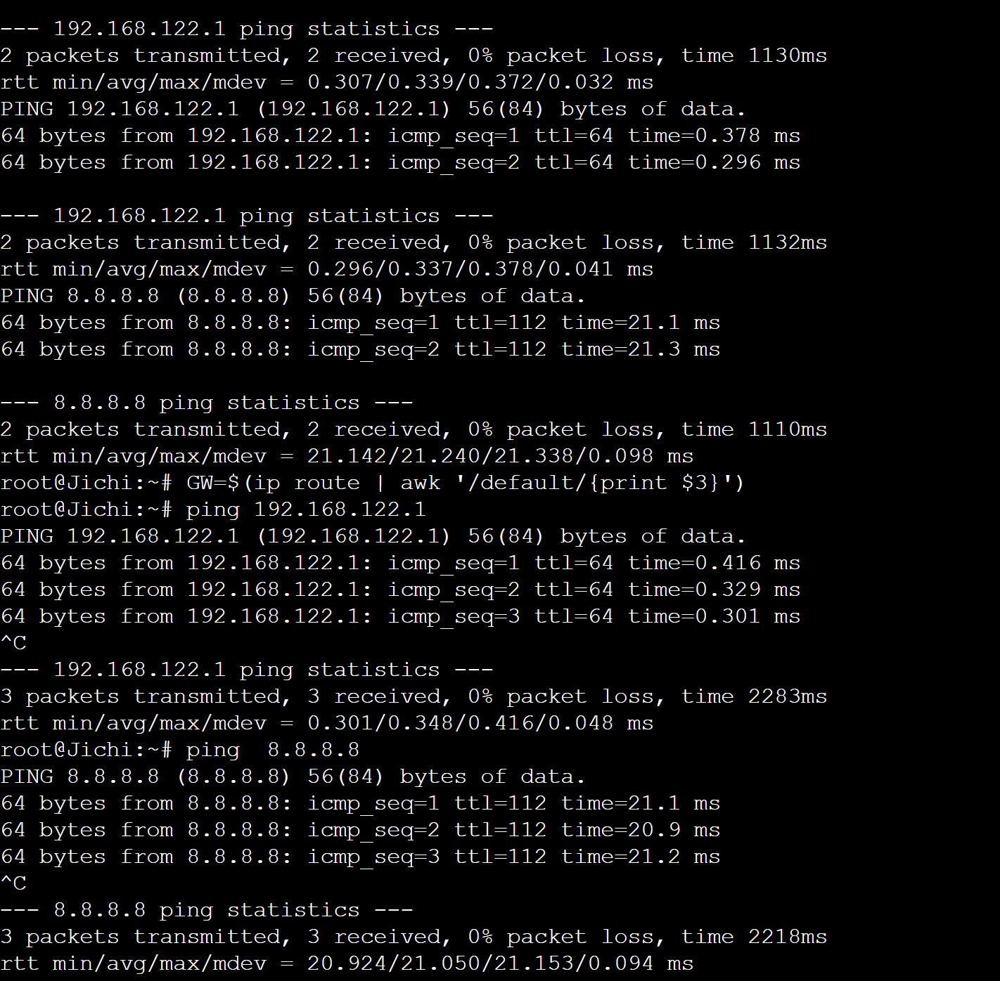

---

## 2. DHCP Server di Tengen

```
apt-get update && apt-get install -y isc-dhcp-server
echo 'INTERFACESv4="eth0"' > /etc/default/isc-dhcp-server
```

Isi `/etc/dhcp/dhcpd.conf` (versi dasar, dipecah jadi pool di soal 4-5):

```
authoritative;
option domain-name "k40.com";
option domain-name-servers 192.231.1.2, 192.231.1.3;
option domain-search "k40.com";
default-lease-time 600;
max-lease-time 7200;

subnet 192.231.4.0 netmask 255.255.255.0 {
}

subnet 192.231.2.0 netmask 255.255.255.0 {
    option routers 192.231.2.1;
    option broadcast-address 192.231.2.255;
    range 192.231.2.10 192.231.2.35;
}

subnet 192.231.3.0 netmask 255.255.255.0 {
    option routers 192.231.3.1;
    option broadcast-address 192.231.3.255;
    range 192.231.3.10 192.231.3.89;
}
```

> Subnet `192.231.4.0` (tanpa range) wajib ada agar dhcpd tidak error `No subnet declaration`.

```
touch /var/lib/dhcp/dhcpd.leases
dhcpd -t -cf /etc/dhcp/dhcpd.conf
service isc-dhcp-server restart
```

**Verifikasi:** `service isc-dhcp-server status` harus `running`.

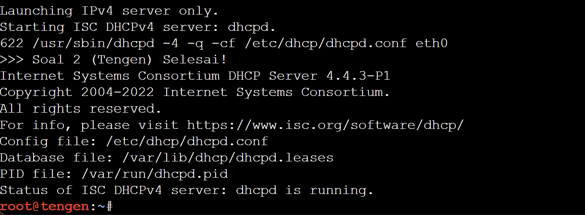

---

## 3. DHCP Relay di Jichi

```
apt-get update && apt-get install -y isc-dhcp-relay
```

Isi `/etc/default/isc-dhcp-relay`:

```
SERVERS="192.231.4.10"
INTERFACES="eth2 eth3 eth4"
OPTIONS=""
```

> `eth2` & `eth3` = sisi client, `eth4` = sisi Tengen (agar balasan server ikut diteruskan).

```
service isc-dhcp-relay restart
```

Di **setiap client**, buat script untuk meminta lease:

```
cat << 'EOF' > /root/client_dhcp.sh
#!/bin/sh
pkill udhcpc 2>/dev/null
ip addr flush dev eth0
ip link set eth0 up
udhcpc -i eth0 -n -q -t 5 -T 2 -x hostname:$(hostname)
ip -4 addr show eth0 | grep inet
ip route
cat /etc/resolv.conf
EOF
chmod +x /root/client_dhcp.sh
sh /root/client_dhcp.sh
```

**Verifikasi:** `pgrep -a dhcrelay` di Jichi harus muncul, dan client menampilkan `lease of 192.231.x.x obtained from 192.231.4.10`.

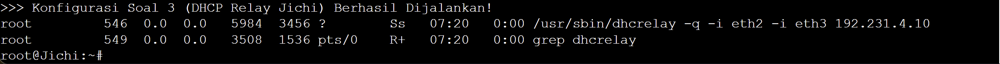

---

## 4. Pool Berbasis MAC (Divisi A)

| Pool   | Client             | Range               |
| ------ | ------------------ | ------------------- |
| Pool 1 | Itadori, Fushiguro | 192.231.2.10 - .35  |
| Pool 2 | Zenin, Okkotsu     | 192.231.2.70 - .95  |
| -      | (tidak dialokasikan) | 192.231.2.36 - .69 |

Cek MAC tiap client dengan `ip link show eth0 | grep ether`, lalu tambahkan di `/etc/dhcp/dhcpd.conf` Tengen:

```
class "pool1" {
    match if substring(hardware, 1, 6) = 02:42:e2:07:da:00
          or substring(hardware, 1, 6) = 02:42:46:07:2d:00;
}
class "pool2" {
    match if substring(hardware, 1, 6) = 02:42:cb:b2:d2:00
          or substring(hardware, 1, 6) = 02:42:fb:4c:da:00;
}

subnet 192.231.2.0 netmask 255.255.255.0 {
    option routers 192.231.2.1;
    option broadcast-address 192.231.2.255;
    pool {
        allow members of "pool1";
        range 192.231.2.10 192.231.2.35;
    }
    pool {
        allow members of "pool2";
        range 192.231.2.70 192.231.2.95;
    }
}
```

```
dhcpd -t -cf /etc/dhcp/dhcpd.conf && service isc-dhcp-server restart
```

Jalankan `sh /root/client_dhcp.sh` di keempat client.

**Verifikasi** di Tengen:

```
grep -E "^lease|hardware ethernet|client-hostname" /var/lib/dhcp/dhcpd.leases
```

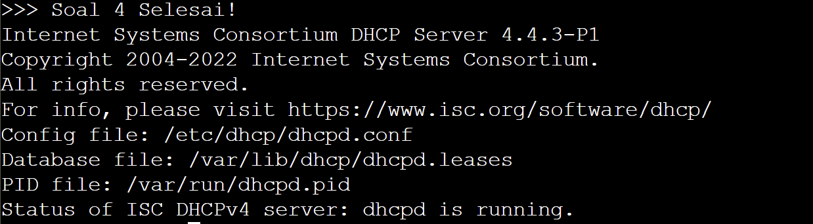

---

## 5. Short Lease & Long Lease (Divisi B)

| Pool       | Client        | Range                | Lease               |
| ---------- | ------------- | -------------------- | ------------------- |
| Short      | Ino, Kusakabe | 192.231.3.10 - .89   | 1800 detik (30 menit) |
| Long       | Miwa          | 192.231.3.100 - .199 | 43200 detik (12 jam)  |

Tambahkan class dan ganti blok subnet `192.231.3.0` di `/etc/dhcp/dhcpd.conf` Tengen (isi MAC sesuai client masing-masing):

```
class "short-lease" {
    match if substring(hardware, 1, 6) = 02:42:c7:7f:09:00
          or substring(hardware, 1, 6) = <MAC_KUSAKABE>;
}
class "long-lease" {
    match if substring(hardware, 1, 6) = <MAC_MIWA>;
}

subnet 192.231.3.0 netmask 255.255.255.0 {
    option routers 192.231.3.1;
    option broadcast-address 192.231.3.255;
    pool {
        allow members of "short-lease";
        range 192.231.3.10 192.231.3.89;
        default-lease-time 1800;
        max-lease-time 1800;
    }
    pool {
        allow members of "long-lease";
        range 192.231.3.100 192.231.3.199;
        default-lease-time 43200;
        max-lease-time 43200;
    }
}
```

```
dhcpd -t -cf /etc/dhcp/dhcpd.conf && service isc-dhcp-server restart
```

**Verifikasi:** jalankan `sh /root/client_dhcp.sh` di Ino, Kusakabe, dan Miwa. Output `udhcpc` menampilkan `lease time 1800` (Ino, Kusakabe) dan `lease time 43200` (Miwa).

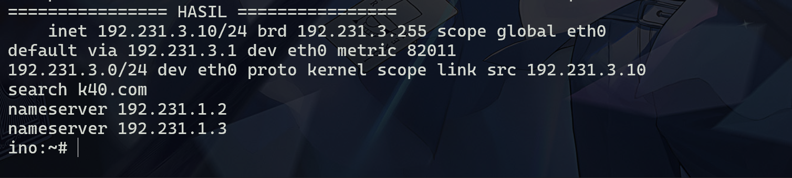

---

## 6. Fixed Address Kugisaki

Tambahkan di akhir `/etc/dhcp/dhcpd.conf` Tengen:

```
host kugisaki {
    hardware ethernet 02:42:a8:e3:32:00;
    fixed-address 192.231.3.99;
}
```

> `.99` berada di luar pool short (`.10-.89`) dan pool long (`.100-.199`), jadi tidak bentrok.

```
dhcpd -t -cf /etc/dhcp/dhcpd.conf && service isc-dhcp-server restart
```

**Verifikasi:** jalankan `sh /root/client_dhcp.sh` di Kugisaki dua kali, IP harus selalu `192.231.3.99` dengan gateway `192.231.3.1`.

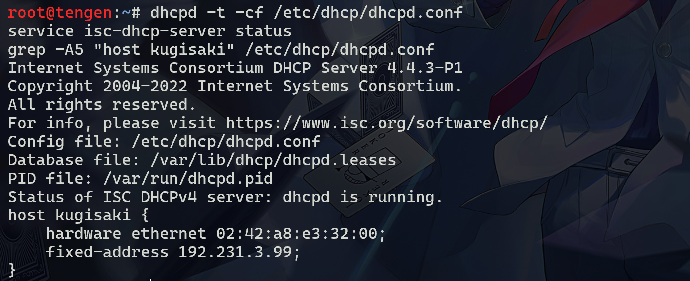

---

## 7. Validasi Konfigurasi Client & Lease

Di **setiap client**:

```
sh /root/client_dhcp.sh
```

| Client             | IP                   | Gateway     | Broadcast     |
| ------------------ | -------------------- | ----------- | ------------- |
| Itadori, Fushiguro | 192.231.2.10 - .35   | 192.231.2.1 | 192.231.2.255 |
| Zenin, Okkotsu     | 192.231.2.70 - .95   | 192.231.2.1 | 192.231.2.255 |
| Ino, Kusakabe      | 192.231.3.10 - .89   | 192.231.3.1 | 192.231.3.255 |
| Miwa               | 192.231.3.100 - .199 | 192.231.3.1 | 192.231.3.255 |
| Kugisaki           | 192.231.3.99 (fixed) | 192.231.3.1 | 192.231.3.255 |

Semua client harus mendapat netmask `/24`, DNS `192.231.1.2` & `192.231.1.3`, dan `search k40.com` di `/etc/resolv.conf`.

Di **Tengen**, cocokkan dengan file lease:

```
grep -E "^lease|starts|ends|hardware ethernet|client-hostname|binding state" /var/lib/dhcp/dhcpd.leases
```

**Verifikasi:**

- 7 lease aktif (semua client kecuali Kugisaki)
- Tidak ada IP/MAC dobel dan tidak ada lease di range `192.231.2.36 - .69`
- Kugisaki tidak muncul di `dhcpd.leases` (normal untuk `fixed-address`)

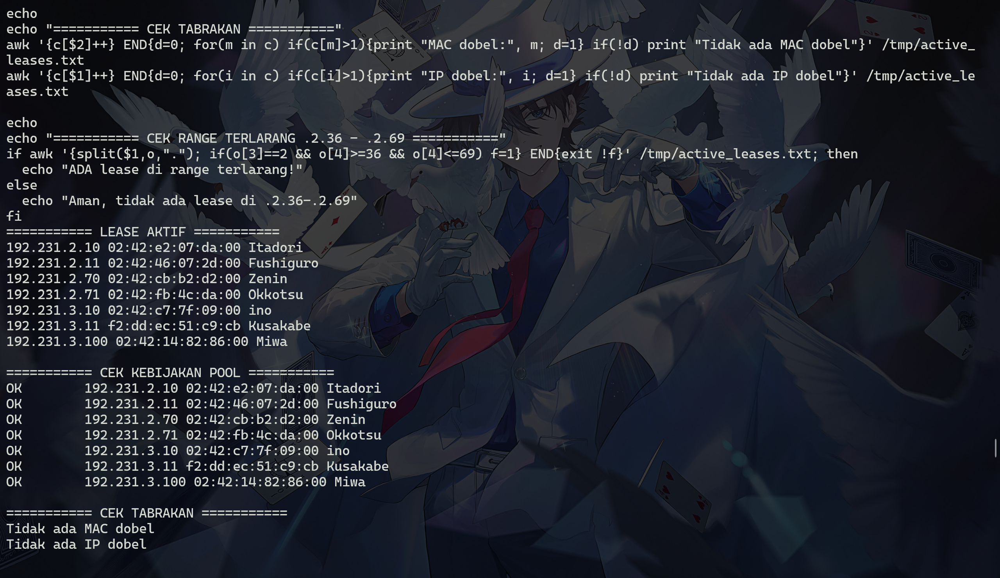

---

## 8. Packet Capture DHCP (DORA + giaddr)

Di **Tengen**, mulai capture 40 detik:

```
apt-get install -y tcpdump
timeout 40 tcpdump -i eth0 -n -vv -w /root/dhcp_net3.pcap 'udp port 67 or udp port 68'
```

Dalam 40 detik tersebut, di **Ino** jalankan:

```
sh /root/client_dhcp.sh
```

Baca hasil capture (difilter berdasarkan MAC Ino):

```
tcpdump -n -vv -r /root/dhcp_net3.pcap 'udp[36:4]=0x0242c77f and udp[40:2]=0x0900' 2>/dev/null \
  | grep -E "DHCP-Message|Gateway-IP|Your-IP|Server-ID|Lease-Time"
```

| Yang dicari        | Hasil                                                    |
| ------------------ | -------------------------------------------------------- |
| Urutan             | `Discover` → `Offer` → `Request` → `ACK`                 |
| Alamat server      | `Server-ID 192.231.4.10`                                 |
| Alamat diberikan   | `Your-IP 192.231.3.x`                                    |
| Lease time         | `Lease-Time 1800`                                        |
| giaddr             | `Gateway-IP 192.231.3.1` (interface eth3 Jichi)          |

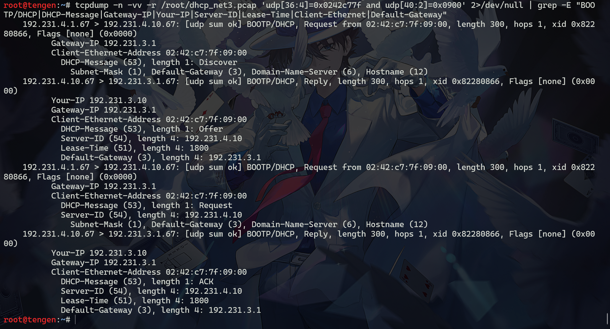

---

## 9. Simulasi Gangguan DHCP Relay

Matikan relay di **Jichi**:

```
service isc-dhcp-relay stop
pkill dhcrelay
```

Di **Itadori**, minta lease baru:

```
pkill udhcpc; ip addr flush dev eth0
udhcpc -i eth0 -n -q -t 3 -T 2
ip -4 addr show eth0
```

| Lokasi       | Gejala                                                     |
| ------------ | ---------------------------------------------------------- |
| Itadori      | `no lease, failing`, eth0 tidak punya IP & default route   |
| Tengen       | `tcpdump -i eth0` tidak menangkap paket DHCP sama sekali   |
| Jichi (eth2) | DISCOVER dari client terlihat, tetapi tidak ada OFFER      |

Pulihkan relay di **Jichi**:

```
service isc-dhcp-relay restart
pgrep -a dhcrelay
```

**Verifikasi:** jalankan `sh /root/client_dhcp.sh` di Itadori, harus kembali dapat IP di Pool 1 (`192.231.2.10 - .35`) dengan gateway `192.231.2.1`.

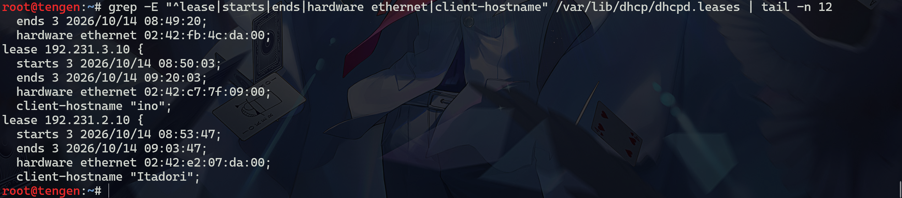

---

## 10. Autostart & Uji Restart

Di **Tengen**, buat script start dan autostart:

```
cat << 'EOF' > /root/start_services.sh
#!/bin/bash
ip route replace default via 192.231.4.1
touch /var/lib/dhcp/dhcpd.leases
rm -f /var/run/dhcpd.pid
service isc-dhcp-server restart
EOF
chmod +x /root/start_services.sh

update-rc.d isc-dhcp-server defaults

cat << 'EOF' > /root/init.sh
#!/bin/sh
( sleep 10; /root/start_services.sh > /root/start_services.log 2>&1 ) &
EOF
chmod +x /root/init.sh
```

Di **Jichi**:

```
cat << 'EOF' > /root/start_services.sh
#!/bin/bash
sysctl -w net.ipv4.ip_forward=1
iptables -t nat -F
iptables -t nat -A POSTROUTING -o eth0 -j MASQUERADE
rm -f /var/run/dhcrelay.pid
service isc-dhcp-relay restart
EOF
chmod +x /root/start_services.sh

update-rc.d isc-dhcp-relay defaults

cat << 'EOF' > /root/init.sh
#!/bin/sh
( sleep 15; /root/start_services.sh > /root/start_services.log 2>&1 ) &
EOF
chmod +x /root/init.sh
```

> Container debinet menjalankan `/root/init.sh` otomatis setiap node di-Start, sehingga service ikut hidup setelah restart.

Di GNS3: **Stop** lalu **Start** Tengen dan Jichi, tunggu ±30 detik.

**Verifikasi:**

```
# Tengen
pgrep -a dhcpd
# Jichi
pgrep -a dhcrelay
iptables -t nat -L POSTROUTING -n
# Setiap client
sh /root/client_dhcp.sh
ping -c 2 192.231.4.10
```

Semua client harus kembali mendapat IP sesuai pool masing-masing (Pool 1, Pool 2, short lease, long lease, dan fixed address Kugisaki).


## Soal 11 - Konfigurasi DNS Master & Slave

Pada tahap ini, kita diminta untuk membuat konfigurasi DNS Server di mana node `utahime` bertindak sebagai **DNS Master** dan node `shoko` bertindak sebagai **DNS Slave** untuk domain `jujutsu.k40.com`. Sinkronisasi dilakukan menggunakan mekanisme *zone transfer*.

Script dijalankan pada `utahime` (Master):

```bash
cat << 'EOF' > /root/soal_11_master.sh
#!/bin/bash
apt-get update
apt-get install -y bind9 dnsutils

cat << 'LOC' > /etc/bind/named.conf.local
zone "jujutsu.k40.com" {
    type master;
    file "/etc/bind/db.jujutsu.k40.com";
    notify yes;
    allow-transfer { 192.231.1.3; };
};
LOC

cat << 'DB' > /etc/bind/db.jujutsu.k40.com
$TTL    604800
@       IN      SOA     utahime.jujutsu.k40.com. root.jujutsu.k40.com. (
                        2026101401      ; Serial
                        604800          ; Refresh
                        86400           ; Retry
                        2419200         ; Expire
                        604800 )        ; Negative Cache TTL
;
@       IN      NS      utahime.jujutsu.k40.com.
@       IN      NS      shoko.jujutsu.k40.com.
@       IN      A       192.231.1.2
utahime IN      A       192.231.1.2
shoko   IN      A       192.231.1.3
DB

service named restart 
echo ">>> Konfigurasi DNS Master (Utahime) Selesai!"
EOF

chmod +x /root/soal_11_master.sh
/root/soal_11_master.sh
```

Script dijalankan pada `shoko` (Slave):

```bash
cat << 'EOF' > /root/soal_11_slave.sh
#!/bin/bash
apt-get update
apt-get install -y bind9 dnsutils

# Konfigurasi zona slave
cat << 'LOC' > /etc/bind/named.conf.local
zone "jujutsu.k40.com" {
    type slave;
    file "/var/cache/bind/db.jujutsu.k40.com";
    masters { 192.231.1.2; };
};
LOC

service named restart 
echo ">>> Konfigurasi DNS Slave (Shoko) Selesai!"
EOF

chmod +x /root/soal_11_slave.sh
/root/soal_11_slave.sh
```

**Pengujian:**
Dijalankan pada node **Client** (misalnya `ino` atau node lain yang memiliki `dnsutils`):
```bash
dig @192.231.1.2 jujutsu.k40.com SOA +short
dig @192.231.1.3 jujutsu.k40.com SOA +short
```

**Hasil:**
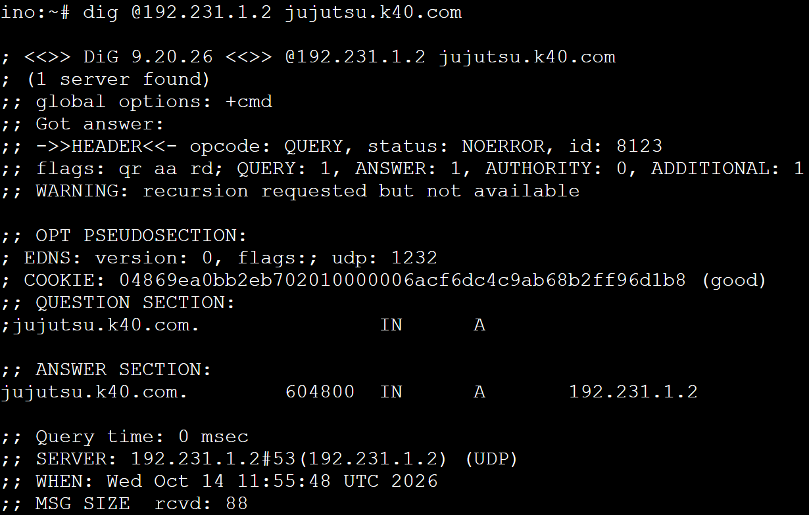
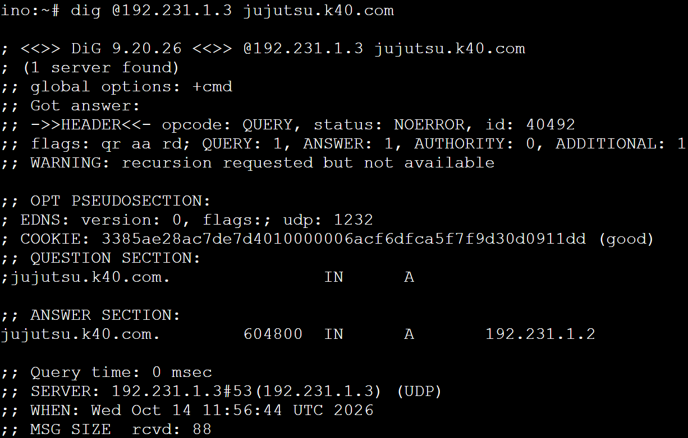


## Soal 12 - DNS CNAME, Reverse DNS, dan Forwarder

Pada soal ini, ditambahkan konfigurasi **CNAME** (`www`), **A Record** untuk `gojo`, zona **Reverse DNS** (PTR Record), serta pengaturan **Forwarder** pada DNS Master (`utahime`) agar client dapat mengakses internet melalui IP router eksternal.

Script dijalankan pada `utahime`:

```bash
cat << 'EOF' > /root/soal_12.sh
#!/bin/bash

cat << 'DB' > /etc/bind/db.jujutsu.k40.com
$TTL    604800
@       IN      SOA     utahime.jujutsu.k40.com. root.jujutsu.k40.com. (
                        2026101402      ; Serial
                        604800          ; Refresh
                        86400           ; Retry
                        2419200         ; Expire
                        604800 )        ; Negative Cache TTL
;
@       IN      NS      utahime.jujutsu.k40.com.
@       IN      NS      shoko.jujutsu.k40.com.
@       IN      A       192.231.1.4
www     IN      CNAME   jujutsu.k40.com.
utahime IN      A       192.231.1.2
shoko   IN      A       192.231.1.3
gojo    IN      A       192.231.1.4
DB

cat << 'LOC' > /etc/bind/named.conf.local
zone "jujutsu.k40.com" {
    type master;
    file "/etc/bind/db.jujutsu.k40.com";
    notify yes;
    allow-transfer { 192.231.1.3; };
};

zone "1.231.192.in-addr.arpa" {
    type master;
    file "/etc/bind/db.192";
};
LOC

cat << 'REV' > /etc/bind/db.192
$TTL    604800
@       IN      SOA     utahime.jujutsu.k40.com. root.jujutsu.k40.com. (
                        2026101401      ; Serial
                        604800          ; Refresh
                        86400           ; Retry
                        2419200         ; Expire
                        604800 )        ; Negative Cache TTL
;
@       IN      NS      utahime.jujutsu.k40.com.
@       IN      NS      shoko.jujutsu.k40.com.
4       IN      PTR     jujutsu.k40.com.
REV

cat << 'OPT' > /etc/bind/named.conf.options
options {
    directory "/var/cache/bind";
    recursion yes;
    allow-query { any; };
    forwarders {
        192.168.122.1;
    };
    forward only;
    dnssec-validation no;
};
OPT

service named restart
service named status
echo ">>> Konfigurasi Soal 12 Selesai!"
EOF

chmod +x /root/soal_12.sh
/root/soal_12.sh
```

**Pengujian:**
Dijalankan pada node **Client** (misalnya `ino`):
```bash
# Pengaturan IP & Resolv Client
ip addr flush dev eth0
ip addr add 192.231.3.10/24 dev eth0
ip link set eth0 up
ip route add default via 192.231.3.1
echo "nameserver 192.168.122.1" > /etc/resolv.conf

# Tes CNAME dan IP
dig www.jujutsu.k40.com

# Tes DNS (Domain Biasa)
dig jujutsu.k40.com

# Tes Reverse DNS
dig -x 192.231.1.4
```

**Hasil:**
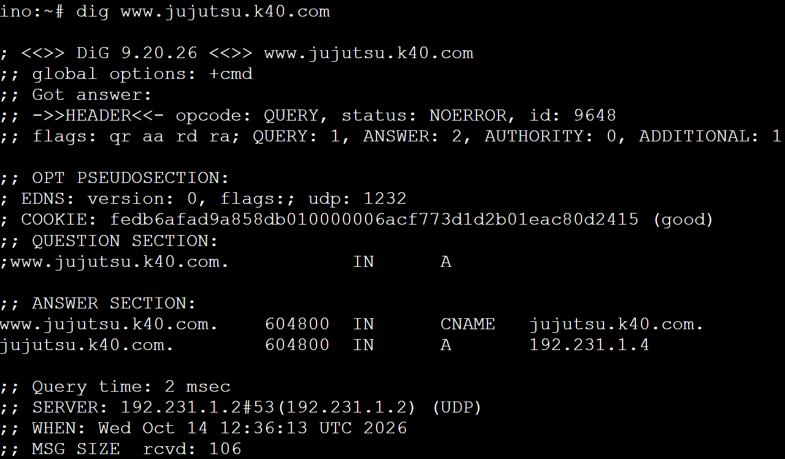
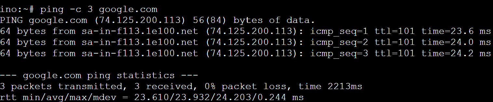
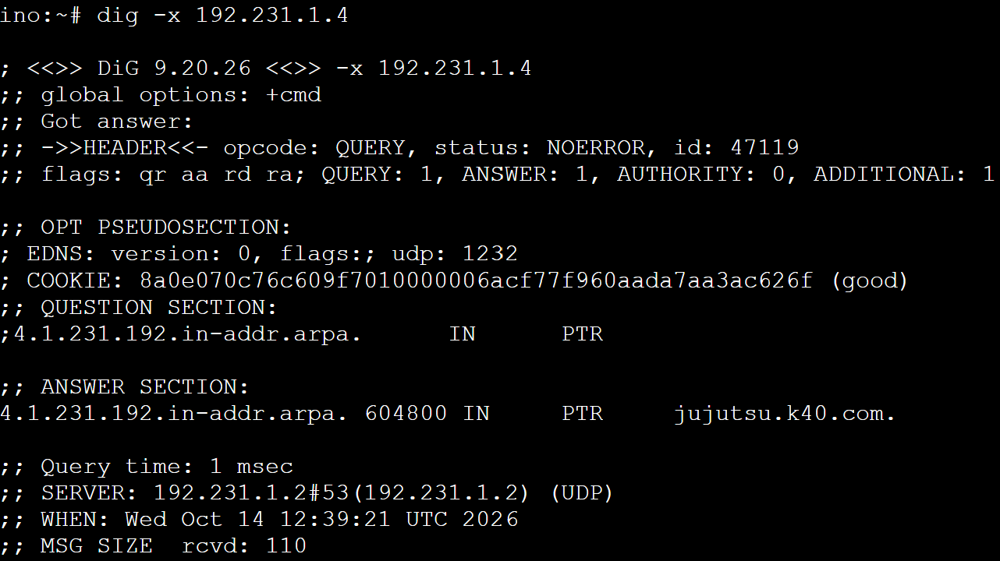


## Soal 13 - Database Master & Slave Replication

Pada soal ini, MariaDB dikonfigurasi dengan skema Master-Slave. Node `yaga` menjadi **Database Master** yang mencatat tabel log request, dan node `inumaki` bertindak sebagai **Database Slave** yang mereplikasi data secara *real-time*.

Script dijalankan pada `yaga` (Master):

```bash
cat << 'EOF' > /root/soal_13_master.sh
#!/bin/bash
apt-get update
apt-get install -y mariadb-server

cat << 'CONF' > /etc/mysql/mariadb.conf.d/50-server.cnf
[mysqld]
bind-address            = 0.0.0.0
server-id               = 1
log_bin                 = /var/log/mysql/mysql-bin.log
CONF

mkdir -p /var/log/mysql 
chown -R mysql:mysql /var/log/mysql 

service mariadb restart

mysql -u root << 'SQL'
CREATE DATABASE db_shibuya_k40;
USE db_shibuya_k40;

CREATE TABLE request_logs (
    id INT AUTO_INCREMENT PRIMARY KEY,
    worker_name VARCHAR(50) NOT NULL,
    client_ip VARCHAR(50) NOT NULL,
    proxy_ip VARCHAR(50) NOT NULL,
    user_agent TEXT,
    created_at TIMESTAMP DEFAULT CURRENT_TIMESTAMP
);

-- User untuk worker
CREATE USER 'kelompok'@'192.231.4.%' IDENTIFIED BY 'password123';
GRANT ALL PRIVILEGES ON db_shibuya_k40.* TO 'kelompok'@'192.231.4.%';

-- User khusus untuk replikasi Slave
CREATE USER 'slaveuser'@'%' IDENTIFIED BY 'slavepass';
GRANT REPLICATION SLAVE ON *.* TO 'slaveuser'@'%';
FLUSH PRIVILEGES;
SQL

echo "=== STATUS MASTER (Catat File & Position untuk Slave) ==="
mysql -u root -e "SHOW MASTER STATUS\G"
EOF

chmod +x /root/soal_13_master.sh
/root/soal_13_master.sh
```

Script dijalankan pada `inumaki` (Slave):

```bash
cat << 'EOF' > /root/soal_13_slave.sh
#!/bin/bash
apt-get update
apt-get install -y mariadb-server

cat << 'CONF' > /etc/mysql/mariadb.conf.d/50-server.cnf
[mysqld]
bind-address            = 0.0.0.0
server-id               = 2
CONF

service mariadb restart

mysql -u root << 'SQL'
CREATE DATABASE IF NOT EXISTS db_shibuya_k40;
USE db_shibuya_k40;
CREATE TABLE IF NOT EXISTS request_logs (
    id INT AUTO_INCREMENT PRIMARY KEY,
    worker_name VARCHAR(50) NOT NULL,
    client_ip VARCHAR(50) NOT NULL,
    proxy_ip VARCHAR(50) NOT NULL,
    user_agent TEXT,
    created_at TIMESTAMP DEFAULT CURRENT_TIMESTAMP
);
SQL

mysql -u root << 'SQL'
STOP SLAVE;
CHANGE MASTER TO 
    MASTER_HOST='192.231.4.51',
    MASTER_USER='slaveuser',
    MASTER_PASSWORD='slavepass',
    MASTER_LOG_FILE='mysql-bin.000001',   -- Ubah sesuai keluaran di Yaga
    MASTER_LOG_POS=660;                   -- Ubah sesuai keluaran di Yaga
START SLAVE;
SQL

echo "=== STATUS SLAVE ==="
mysql -u root -e "SHOW SLAVE STATUS\G" | grep -E "Slave_IO_Running|Slave_SQL_Running|Seconds_Behind_Master|Last_Error"
EOF

chmod +x /root/soal_13_slave.sh
/root/soal_13_slave.sh
```

**Pengujian:**
Dijalankan pada node **yaga** (Master) untuk melakukan insert, dan pada node **inumaki** (Slave) untuk melihat hasil replikasi:
```bash
# Di node Yaga (Master)
mysql -u root -e "USE db_shibuya_k40; INSERT INTO request_logs (worker_name, client_ip, proxy_ip) VALUES ('TEST_WORKER', '192.168.1.1', '10.0.0.1');"

# Di node Inumaki (Slave)
mysql -u root -e "USE db_shibuya_k40; SELECT * FROM request_logs;"
```

**Hasil:**
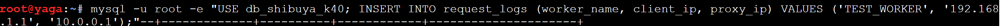
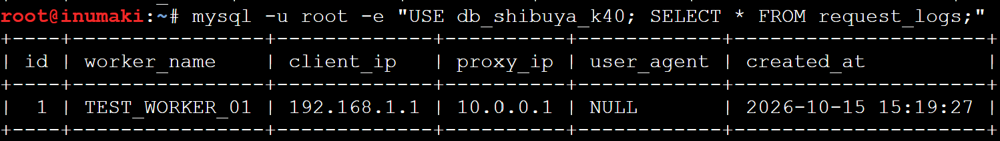


## Soal 14 - Web Frontend & API Worker

Aplikasi web disebarkan ke beberapa node pekerja (worker). Node `maki` dan `panda` bertindak sebagai **Web Frontend** yang hanya menerima permintaan dari proxy utama (`gojo`). Node `nanami`, `todo`, dan `kirara` bertindak sebagai **API Worker** yang terkoneksi ke database dan hanya menerima permintaan dari load balancer API (`geto`).

Script dijalankan pada Frontend (`maki`, `panda`):

```bash
cat << 'EOF' > /root/soal_14_web.sh
#!/bin/bash
apt-get update
apt-get install -y nginx php-fpm

PHP_VER=$(php -v | head -n 1 | awk '{print $2}' | cut -d. -f1,2)

cat << 'WEB' > /var/www/html/index.php
<?php
echo "<h1>Aplikasi Web Jujutsu</h1>";
echo "<h3>Frontend dilayani oleh Worker: <b>" . gethostname() . "</b></h3>";
?>
WEB
rm -f /var/www/html/index.html

cat << NGINX > /etc/nginx/sites-available/default
server {
    listen 80;
    server_name _;
    root /var/www/html;
    index index.php index.html index.htm;

    # Hanya gojo (Web Proxy)
    allow 192.231.1.4;
    deny all;

    location / {
        try_files \$uri \$uri/ =404;
    }

    location ~ \.php$ {
        include snippets/fastcgi-php.conf;
        fastcgi_pass unix:/run/php/php${PHP_VER}-fpm.sock;
    }
}
NGINX

service php${PHP_VER}-fpm restart
service nginx restart
echo ">>> Konfigurasi Web Frontend di $(hostname) Selesai!"
EOF

chmod +x /root/soal_14_web.sh
/root/soal_14_web.sh
```

Script dijalankan pada API (`nanami`, `todo`, `kirara`):

```bash
cat << 'EOF' > /root/soal_14_api.sh
#!/bin/bash
apt-get update
apt-get install -y nginx php-fpm php-mysql

PHP_VER=$(php -v | head -n 1 | awk '{print $2}' | cut -d. -f1,2)

mkdir -p /var/www/html/api
cat << 'API' > /var/www/html/api/index.php
<?php
$host = '192.231.4.51'; // IP DB Master (Yaga)
$db = 'db_shibuya_k40';
$user = 'kelompok';
$pass = 'password123';

$worker_name = gethostname();
$proxy_ip = $_SERVER['REMOTE_ADDR'];
$client_ip = isset($_SERVER['HTTP_X_FORWARDED_FOR']) ? $_SERVER['HTTP_X_FORWARDED_FOR'] : $proxy_ip;
$user_agent = isset($_SERVER['HTTP_USER_AGENT']) ? $_SERVER['HTTP_USER_AGENT'] : 'Unknown';

$conn = new mysqli($host, $user, $pass, $db);
if ($conn->connect_error) {
    die("Koneksi Database Gagal: " . $conn->connect_error);
}

$sql = "INSERT INTO request_logs (worker_name, client_ip, proxy_ip, user_agent) 
        VALUES ('$worker_name', '$client_ip', '$proxy_ip', '$user_agent')";

if ($conn->query($sql) === TRUE) {
    echo "Log request berhasil dicatat oleh API Worker: " . $worker_name;
} else {
    echo "Error: " . $conn->error;
}
$conn->close();
?>
API

cat << NGINX > /etc/nginx/sites-available/default
server {
    listen 80;
    server_name _;
    root /var/www/html;
    index index.php index.html index.htm;

    # Hanya geto (API Load Balancer)
    allow 192.231.4.20;
    deny all;

    location / {
        try_files \$uri \$uri/ =404;
    }

    location ~ \.php$ {
        include snippets/fastcgi-php.conf;
        fastcgi_pass unix:/run/php/php${PHP_VER}-fpm.sock;
    }
}
NGINX

service php${PHP_VER}-fpm restart
service nginx restart
echo ">>> Konfigurasi API Worker di $(hostname) Selesai!"
EOF

chmod +x /root/soal_14_api.sh
/root/soal_14_api.sh
```

**Pengujian:**
Dijalankan pada node **Client** atau secara langsung dari router untuk melihat status akses (Forbidden/Akses Web):
```bash
curl -i http://192.231.4.31/
curl -i http://192.231.4.41/api/
```

**Hasil:**
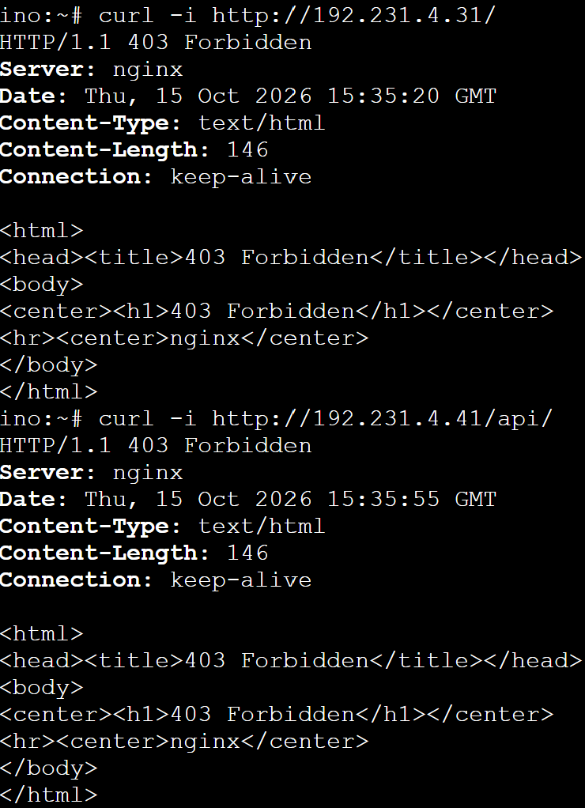
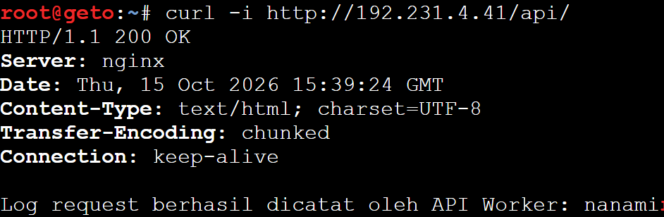
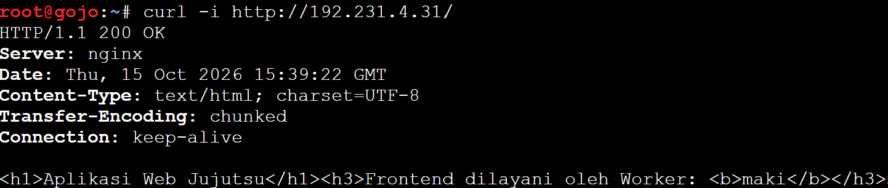


## Soal 15 - API Load Balancer (`geto`)

Node `geto` dikonfigurasi sebagai Load Balancer menggunakan algoritma *weighted round-robin* untuk membagi beban trafik menuju endpoint API, dengan pembagian bobot untuk `nanami` (3) dan `todo` (1).

Script dijalankan pada `geto`:

```bash
cat << 'EOF' > /root/soal_15.sh
#!/bin/bash
apt-get update
apt-get install -y nginx

cat << 'NGINX' > /etc/nginx/sites-available/default
upstream api_cluster {
    server 192.231.4.41 weight=3; # nanami
    server 192.231.4.42 weight=1; # todo
}

server {
    listen 80;
    server_name _;

    location /api/{
        proxy_pass http://api_cluster;
        proxy_set_header Host $host;
        proxy_set_header X-Real-IP $remote_addr;
        proxy_set_header X-Forwarded-For $proxy_add_x_forwarded_for;
    }
}
NGINX

service nginx restart
echo ">>> Konfigurasi Load Balancer Selesai!"
EOF

chmod +x /root/soal_15.sh
/root/soal_15.sh
```

**Pengujian:**
Dijalankan pada node **Client** (atau dari `gojo`):
```bash
# Melakukan request berulang untuk melihat distribusi load balancer (3:1)
for i in {1..4}; do curl -s http://192.231.4.20/api/ ; echo "" ; done
```

**Hasil:**
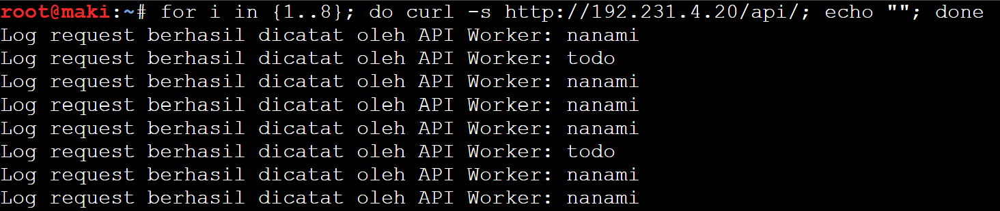


## Soal 16 - Main Reverse Proxy (`gojo`)

Node `gojo` berfungsi sebagai pintu masuk utama jaringan (Reverse Proxy) untuk memfasilitasi akses dari klien menuju domain `jujutsu.k40.com` dan meneruskan rute trafik sesuai dengan URL path yang diminta (Frontend atau API).

Script dijalankan pada `gojo`:

```bash
cat << 'EOF' > /root/soal_16.sh
#!/bin/bash
apt-get update
apt-get install -y nginx

cat << 'NGINX' > /etc/nginx/sites-available/default
upstream web_frontend {
    server 192.231.4.31; # maki
    server 192.231.4.32; # panda
}

server {
    listen 80;
    server_name jujutsu.k40.com www.jujutsu.k40.com;

    proxy_set_header Host $host;
    proxy_set_header X-Real-IP $remote_addr;
    proxy_set_header X-Forwarded-For $proxy_add_x_forwarded_for;

    location / {
        proxy_pass http://web_frontend;
    }

    location /api/ {
        proxy_pass http://192.231.4.20/api/;
    }
}
NGINX

service nginx restart
echo ">>> Konfigurasi Reverse Proxy Selesai!"
EOF

chmod +x /root/soal_16.sh
/root/soal_16.sh
```

**Pengujian:**
Dijalankan pada node **Client**:
```bash
# Menguji pembagian frontend
for i in {1..4}; do curl -s http://jujutsu.k40.com/ | grep "Frontend"; done

# Menguji endpoint API via gojo
curl -s http://jujutsu.k40.com/api/
```

**Hasil:**
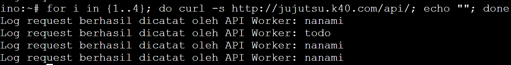
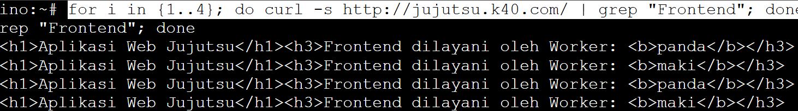


## Soal 17 - Konfigurasi Real IP & Trust Proxy

Agar sistem log pada backend mendapatkan alamat IP klien asli (bukan IP proksi Nginx), parameter `set_real_ip_from` dikonfigurasi di Load Balancer API (`geto`), dan skrip PHP di node API dimodifikasi untuk menangkap Header `HTTP_X_REAL_IP`.

Script dijalankan pada `geto`:

```bash
cat << 'EOF' > /root/soal_17_geto.sh
#!/bin/bash
cat << 'NGINX' > /etc/nginx/sites-available/default
upstream api_cluster {
    server 192.231.4.41 weight=3; # nanami
    server 192.231.4.42 weight=1; # todo
}

server {
    listen 80;
    server_name _;

    # Hanya request dari gojo
    set_real_ip_from 192.231.1.4;
    real_ip_header X-Forwarded-For;
    real_ip_recursive on;

    location /  {
        proxy_pass http://api_cluster;
        proxy_set_header Host $host;
        
        proxy_set_header X-Real-IP $remote_addr; 
        proxy_set_header X-Forwarded-For $proxy_add_x_forwarded_for;
    }
}
NGINX

service nginx restart
echo ">>> Konfigurasi Trust Proxy di geto Selesai!"
EOF

chmod +x /root/soal_17_geto.sh
/root/soal_17_geto.sh
```

Script dijalankan pada API (`nanami`, `todo`):

```bash
cat << 'EOF' > /root/soal_17_api.sh
#!/bin/bash
cat << 'API' > /var/www/html/api/index.php
<?php
$host = '192.231.4.51'; // IP Yaga
$db = 'db_shibuya_k40';
$user = 'kelompok';
$pass = 'password123';

$worker_name = gethostname();
$proxy_ip = $_SERVER['REMOTE_ADDR']; 

$client_ip = isset($_SERVER['HTTP_X_REAL_IP']) ? $_SERVER['HTTP_X_REAL_IP'] : $proxy_ip;
$user_agent = isset($_SERVER['HTTP_USER_AGENT']) ? $_SERVER['HTTP_USER_AGENT'] : 'Unknown';

$conn = new mysqli($host, $user, $pass, $db);
if ($conn->connect_error) {
    die("Koneksi Database Gagal: " . $conn->connect_error);
}

$sql = "INSERT INTO request_logs (worker_name, client_ip, proxy_ip, user_agent) 
        VALUES ('$worker_name', '$client_ip', '$proxy_ip', '$user_agent')";

if ($conn->query($sql) === TRUE) {
    echo "Log API dari IP asli [$client_ip] dicatat oleh: $worker_name\n";
} else {
    echo "Error: " . $conn->error;
}
$conn->close();
?>
API
echo ">>> Skrip API di $(hostname) Selesai Diupdate!"
EOF

chmod +x /root/soal_17_api.sh
/root/soal_17_api.sh
```

**Pengujian:**
Dijalankan secara berurutan di sisi **Client** dan di database Master **yaga**:
```bash
# Dijalankan pada node Client
curl http://jujutsu.k40.com/api/

# Dijalankan pada node Database Master (yaga)
mysql -u root -e "USE db_shibuya_k40; SELECT id, worker_name, client_ip, proxy_ip FROM request_logs;"
```

**Hasil:**
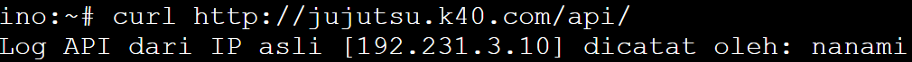
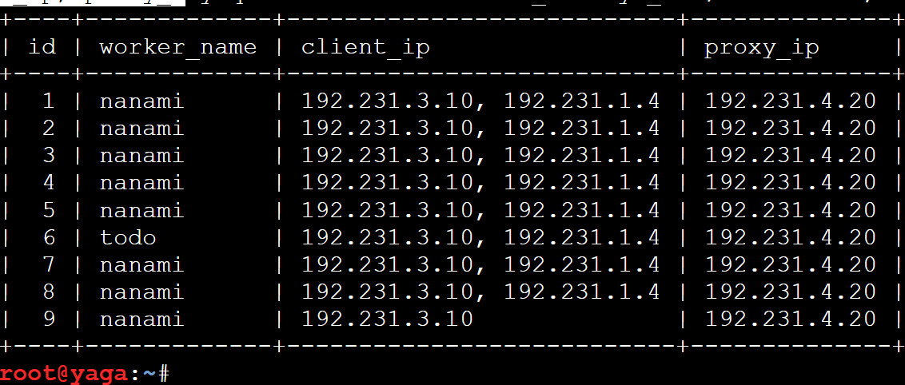


## Soal 18 - Backup Server & Health Check

Untuk meningkatkan toleransi kegagalan sistem (*fault tolerance*), fitur pemeriksaan kesehatan server (`max_fails` dan `fail_timeout`) dikonfigurasi pada node upstream utama di `geto`. Node `kirara` diatur sebagai **Backup Server** yang akan menampung seluruh beban *request* apabila *node worker* utama mengalami *downtime*.

Script dijalankan pada `geto`:

```bash
cat << 'EOF' > /root/soal_18.sh
#!/bin/bash
cat << 'NGINX' > /etc/nginx/sites-available/default
upstream api_cluster {
    server 192.231.4.41 weight=3 max_fails=2 fail_timeout=5s; # nanami
    server 192.231.4.42 weight=1 max_fails=2 fail_timeout=5s; # todo
    
    server 192.231.4.43 backup; # kirara
}

server {
    listen 80;
    server_name _;

    set_real_ip_from 192.231.1.4;
    real_ip_header X-Forwarded-For;
    real_ip_recursive on;

    location / {
        proxy_pass http://api_cluster;
        proxy_set_header Host $host;
        proxy_set_header X-Real-IP $remote_addr; 
        proxy_set_header X-Forwarded-For $proxy_add_x_forwarded_for;
    }
}
NGINX

service nginx restart
echo ">>> Konfigurasi Backup Server dan Health Check di geto Selesai!"
EOF

chmod +x /root/soal_18.sh
/root/soal_18.sh
```

**Pengujian:**
Dijalankan pada node **Client** (setelah mematikan layanan nginx di node `nanami` dan `todo` untuk menguji *failover*):
```bash
for i in {1..3}; do curl -s http://jujutsu.k40.com/api/; echo ""; done
```

**Hasil:**
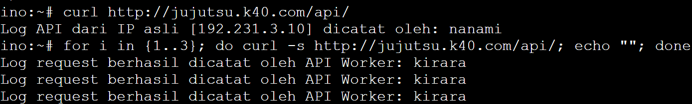


## Soal 19 - Proxy Caching & Rate Limiting

Pada tahap ini, *Reverse Proxy* (`gojo`) diperkuat dengan sistem **Caching** pada level web frontend untuk meminimalisasi beban request berulang. Selain itu, **Rate Limiting** juga diterapkan pada endpoint `/api/` (maksimal 10 request per detik) untuk mencegah penumpukan jalur trafik.

Script dijalankan pada `gojo`:

```bash
cat << 'EOF' > /root/soal_19.sh
#!/bin/bash
apt-get update
apt-get install -y nginx

mkdir -p /var/cache/nginx

cat << 'NGINX' > /etc/nginx/sites-available/default
# 1. Zone Proxy Cache
proxy_cache_path /var/cache/nginx levels=1:2 keys_zone=WEB_CACHE:10m max_size=100m inactive=10m use_temp_path=off;

# 2. Zone Rate Limiting
limit_req_zone $binary_remote_addr zone=API_LIMIT:10m rate=10r/s;

upstream web_frontend {
    server 192.231.4.31; # maki
    server 192.231.4.32; # panda
}

server {
    listen 80;
    server_name jujutsu.k40.com www.jujutsu.k40.com;

    proxy_set_header Host $host;
    proxy_set_header X-Real-IP $remote_addr;
    proxy_set_header X-Forwarded-For $proxy_add_x_forwarded_for;

    location / {
        proxy_pass http://web_frontend;
        proxy_cache WEB_CACHE;
        proxy_cache_valid 200 10m;
        add_header X-Cache-Status $upstream_cache_status;
    }

    location /api/ {
        limit_req zone=API_LIMIT nodelay;
        proxy_pass http://192.231.4.20/api/;
    }
}
NGINX

service nginx restart
echo ">>> Konfigurasi Proxy Cache & Rate Limiting di gojo Selesai!"
EOF

chmod +x /root/soal_19.sh
/root/soal_19.sh
```

**Pengujian:**
Dijalankan pada node **Client**:
```bash
# Tes Cache (Perhatikan tulisan HIT/MISS pada X-Cache-Status)
curl -i http://jujutsu.k40.com/ | grep X-Cache-Status

# Tes Rate Limiting (Akan muncul response code 503 setelah melebihi batas)
(for i in {1..15}; do curl -s -o /dev/null -w "%{http_code}\n" http://jujutsu.k40.com/api/ & done; wait)
```

**Hasil:**
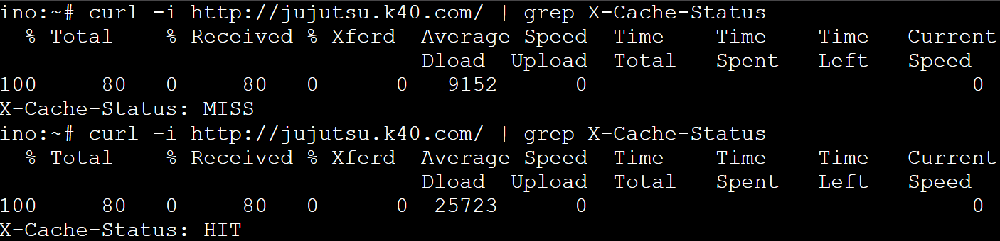
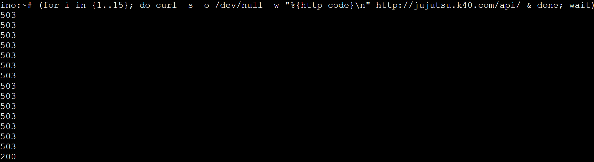
